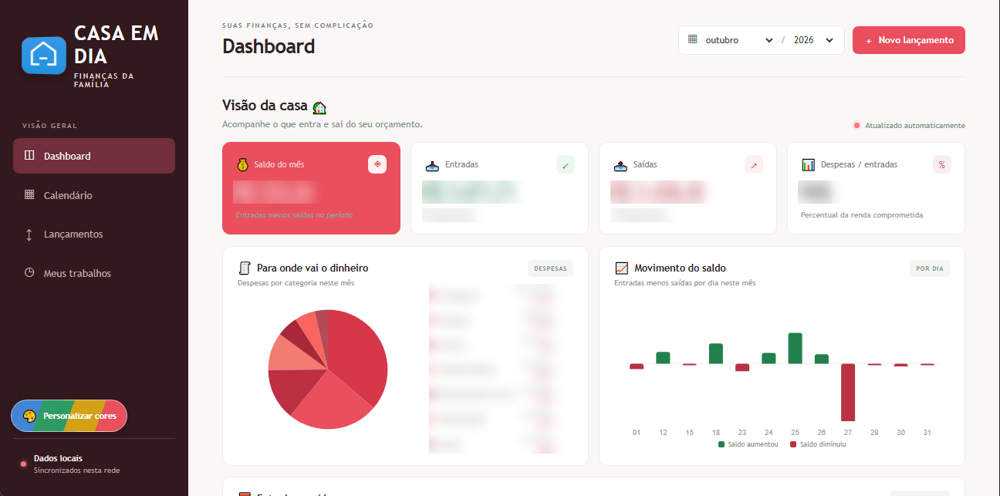
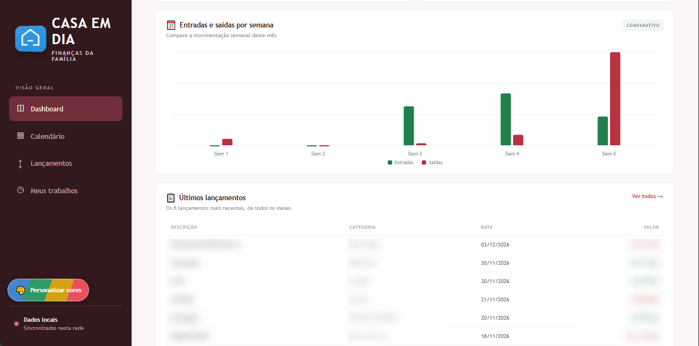
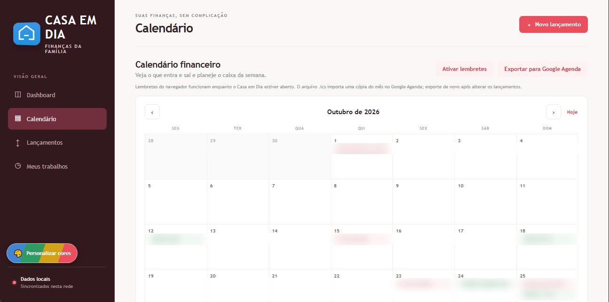
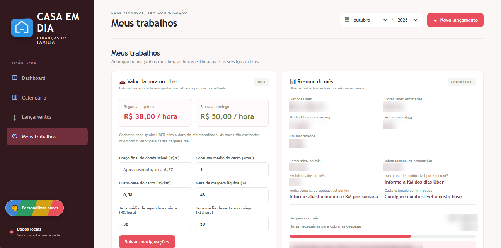
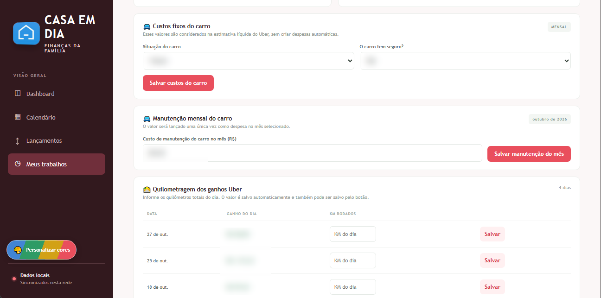
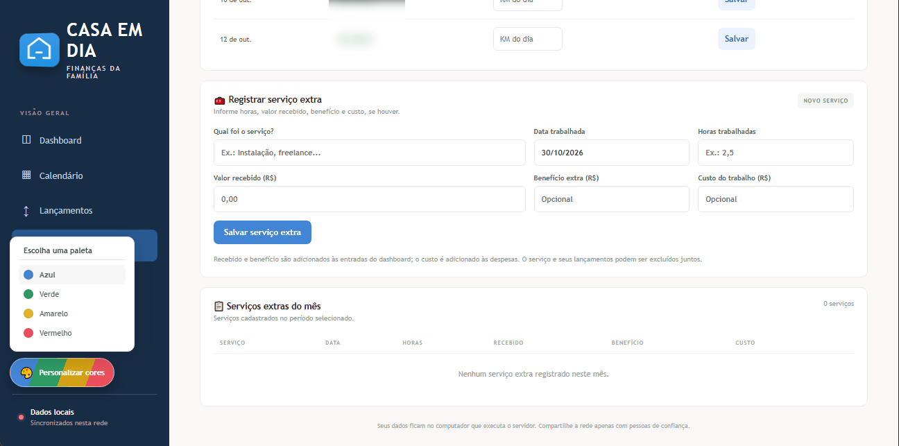

# Casa em Dia

Dashboard gratuito e leve para organizar as finanças da casa. Acompanhe entradas, despesas e saldo por mês, veja gráficos e registre ganhos de trabalho e quilometragem. A interface usa HTML, CSS e JavaScript sem bibliotecas externas; o servidor e o banco de dados usam apenas Python e SQLite.



## Telas

| Comparativo semanal e últimos lançamentos | Calendário financeiro |
| --- | --- |
|  |  |
| **Meus trabalhos: valor da hora e resumo do mês** | **Custos do carro e quilometragem** |
|  |  |
| **Serviços extras e paletas de cores** | |
|  | |

Valores e descrições dos lançamentos aparecem borrados nas imagens para proteger dados pessoais.

## Recursos

- Dashboard mensal com seleção separada de mês e ano, totais, gráficos por categoria, movimento diário e comparativo semanal.
- Calendário financeiro com detalhes das entradas e despesas ao passar ou focar uma data, projeção semanal do caixa, reserva necessária em reais e estimativa de horas de trabalho.
- Exportação dos lançamentos do mês em `.ics` para importar no Google Agenda, com alertas na véspera e no dia (exportação pontual, sem sincronização automática); lembretes do navegador no dia do vencimento enquanto o app estiver aberto.
- Histórico dos oito lançamentos mais recentes, sem limitar os dados usados nos totais mensais.
- Personalização visual com paletas azul, verde, amarelo ou vermelho, aplicada também ao saldo do mês e à barra de navegação, e salva localmente no navegador.
- Entradas são sempre destacadas em verde e despesas em vermelho, independentemente da paleta escolhida.
- Logotipo da casa exibido a partir da imagem `transferir.jfif`.
- Registro e filtro de entradas e despesas, com categorias comuns e valores no formato brasileiro.
- Na lista de lançamentos, ordenação crescente ou decrescente por descrição, categoria, data e valor; visualização e edição em um balão flutuante, com proteção para valores gerenciados por serviços extras ou custos mensais do carro.
- Registro de lançamentos recorrentes mensais por uma duração escolhida de 2 a 120 meses; as ocorrências preservam o dia do mês (ou usam o último dia quando necessário).
- Registro de ganhos por trabalho, serviços extras, horas trabalhadas e despesas do veículo.
- Quilometragem Uber salva automaticamente, com custo estimado e gasto real de combustível por quilômetro, totais mensais e médias semanais baseadas nas despesas de combustível registradas.
- Cadastro da situação do carro (próprio, alugado ou financiado) e dos valores mensais de aluguel/financiamento e seguro; esses custos entram na estimativa líquida do Uber, sem criar lançamentos duplicados.
- Categorias de despesas específicas para combustível e custos do carro.
- Taxas horárias padrão de R$ 38/h de segunda a quinta e R$ 50/h de sexta a domingo (ajustáveis), preço efetivo do combustível em R$/L, consumo do carro em km/L, custo-base em R$/km e margem configuráveis.
- Atualização automática entre dispositivos conectados ao servidor local.
- Banco pessoal criado automaticamente em `data/household.sqlite3`. O repositório não contém dados financeiros de exemplo ou dados de usuários.

## Requisitos

- Python 3.9 ou superior.
- Um navegador moderno.

## Instalação e execução

Clone o repositório e inicie o servidor:

```powershell
git clone https://github.com/brenolrocha22/CASA-EM-DIA.git
cd CASA-EM-DIA
python server.py
```

Abra <http://127.0.0.1:8765>. O servidor, por padrão, aceita conexões somente do próprio computador. No Windows, o atalho `abrir_dashboard.vbs` (dê dois cliques) inicia o servidor nesse mesmo modo e abre o navegador; ele precisa ficar na pasta do projeto e exige o Python instalado.

### Acessar em outros dispositivos da casa

Em uma rede Wi-Fi privada e confiável, inicie o servidor aceitando conexões locais:

```powershell
python server.py --host 0.0.0.0 --port 8765
```

Descubra o endereço IPv4 do computador servidor (`ipconfig` no Windows) e acesse `http://IP-DO-COMPUTADOR:8765` no outro dispositivo. Se necessário, permita a conexão no Firewall do Windows **somente em redes privadas confiáveis**.

O servidor não tem autenticação nem HTTPS. Não o exponha à internet nem use redes públicas ou compartilhadas. Cada instalação mantém seus próprios dados localmente; faça cópia de segurança do arquivo `data/household.sqlite3`.

## Privacidade e licença

O banco SQLite, os ambientes virtuais e caches locais são excluídos pelo `.gitignore`. Não envie seu arquivo de banco, cópias de segurança, senhas nem outros dados pessoais ao repositório. Para usar o projeto em sua casa, clone o código e execute-o localmente: um banco vazio será criado no seu computador.

Este projeto é distribuído gratuitamente sob a licença MIT. Consulte [LICENSE](./LICENSE).

## Referências técnicas

- [Python `http.server`](https://docs.python.org/3/library/http.server.html)
- [Python `sqlite3`](https://docs.python.org/3/library/sqlite3.html)
- [MDN: Canvas API](https://developer.mozilla.org/docs/Web/API/Canvas_API)
- [MDN: `<dialog>`](https://developer.mozilla.org/docs/Web/HTML/Element/dialog)
